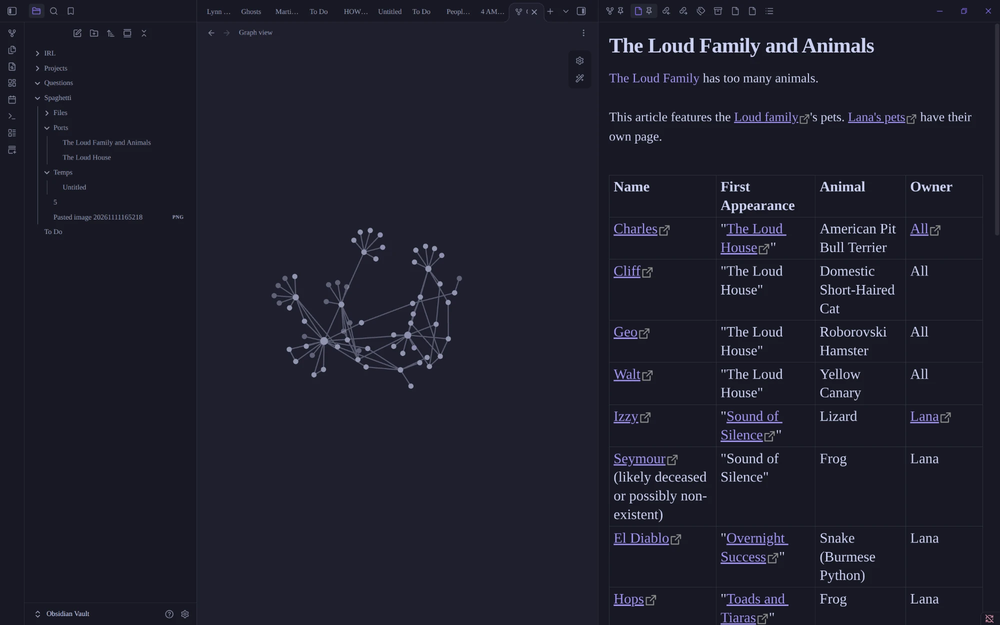
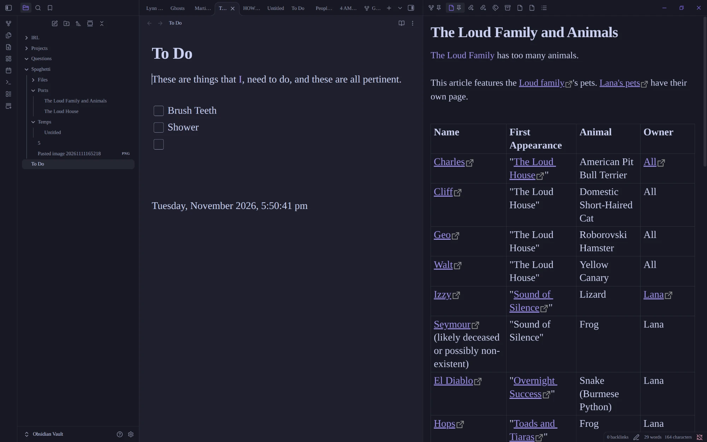
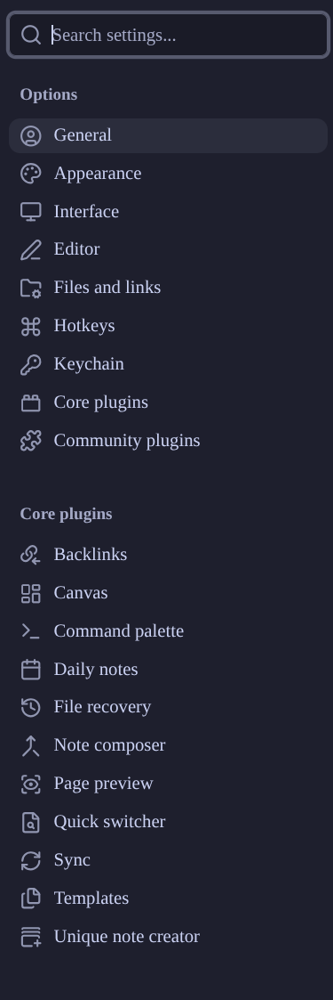
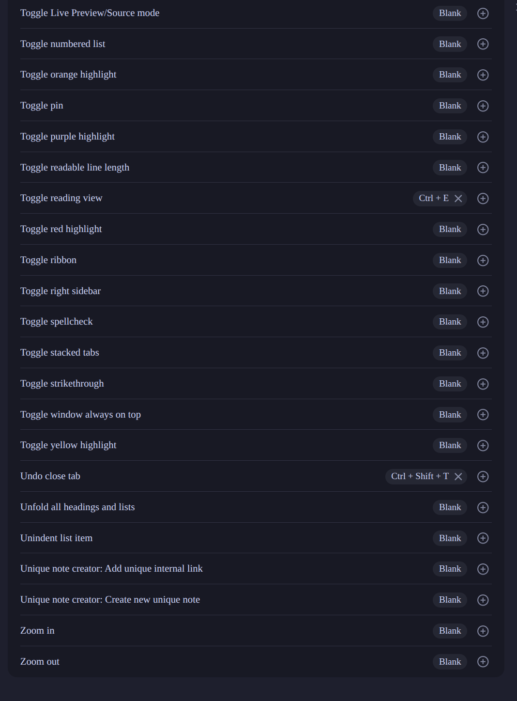

# Screenshots

Reference screenshots of the layout Exhaust aims for.

## Graph view

On the far left, a bar of utilities. Next to it, the files as a tree of folders that are handled within the app rather than in the actual filesystem. In the middle, a graph view showing the links between notes. On the right, an open note for reference.

## Editing

Everything is the same, except the graph view is now an active note being edited, and the note on the right serves as a reference.

## Vaults

The vault button at the bottom left of the file tree lets the user switch between which set of Markdown files to use.

## Settings

The settings menu to copy. A search box sits at the top. Below it, Options: General, Appearance, Interface, Editor, Files and links, Hotkeys, Keychain, Core plugins and Community plugins. Below that, one entry for each core plugin: Backlinks, Canvas, Command palette, Daily notes, File recovery, Note composer, Page preview, Quick switcher, Sync, Templates and Unique note creator.

## Hotkeys

The hotkeys list to copy. One row per command, in alphabetical order, with the command name on the left. On the right of each row is a shortcut chip, or "Blank" when none is set, and a plus button to add another shortcut. A chip with a shortcut has a cross to remove it. Examples in the screenshot: Toggle reading view (Ctrl + E), Undo close tab (Ctrl + Shift + T), and many commands with no shortcut, such as Toggle numbered list, the highlight colors, Toggle spellcheck, Toggle stacked tabs, Unique note creator and Zoom in and out.

## Settings pages

Full-page screenshots of 28 settings pages, in `settings/`. **These are the guideline for what Exhaust's settings should look like**: follow their layout, grouping, order and the options they offer, as in the README's Settings section. As with the other screenshots, copy the layout and the list of options, not the artwork or text.

- **Options:** `general-settings.png`, `appearance-settings.png`, `interface-settings.png`, `editor-settings-pt-1.png`, `editor-settings-part-2.png`, `files-and-links-settings-pt-1.png`, `files-and-links-pt-2.png`.
- **Hotkeys:** `hotkeys-1.png` to `hotkeys-9.png`, the complete list across nine pages, in alphabetical order.
- **Built-in features:** `core-plugins-pt-1-settings.png` and `core-plugins-pt-2.png` (the list of features with their switches), then one page each for `backlinks-settings.png`, `canvas-settings.png`, `command-pallete-settings.png`, `daily-notes-settings.png`, `file-recovery-settings.png`, `new-note-creator-settings.png`, `note-composer-settings.png`, `page-preview-settings.png`, `quick-switcher-settings.png` and `template-settings.png`.
